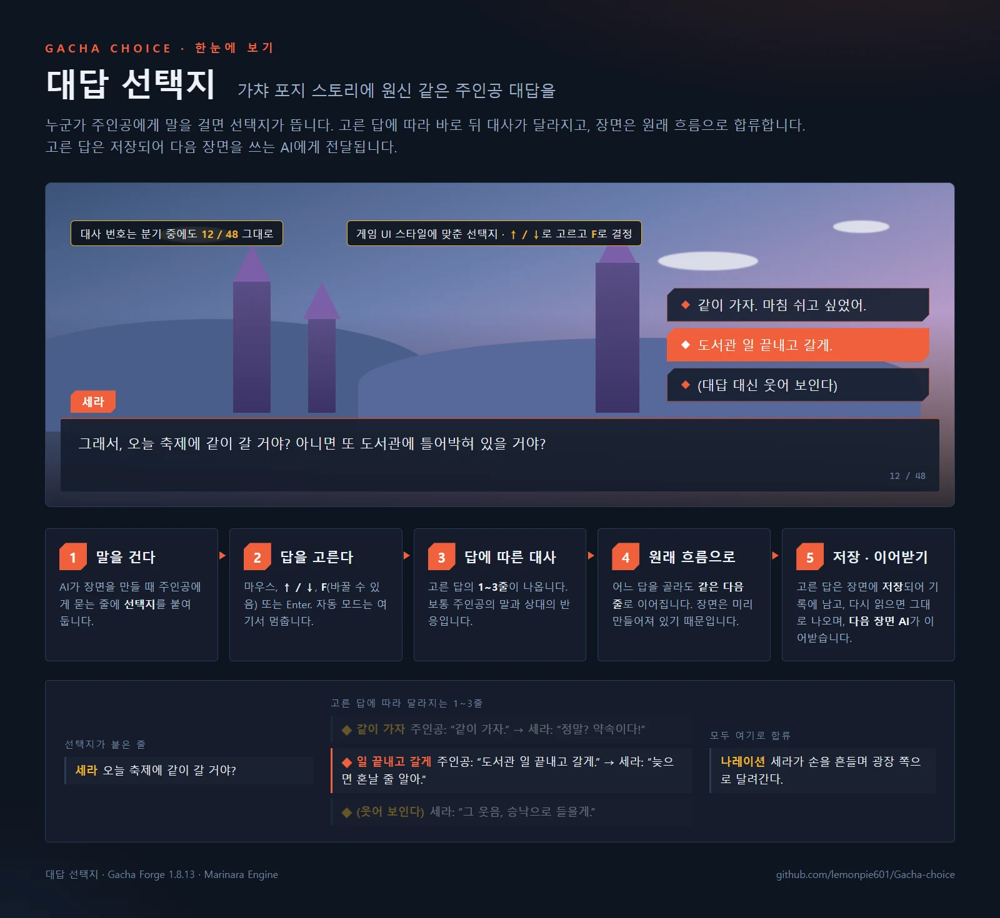
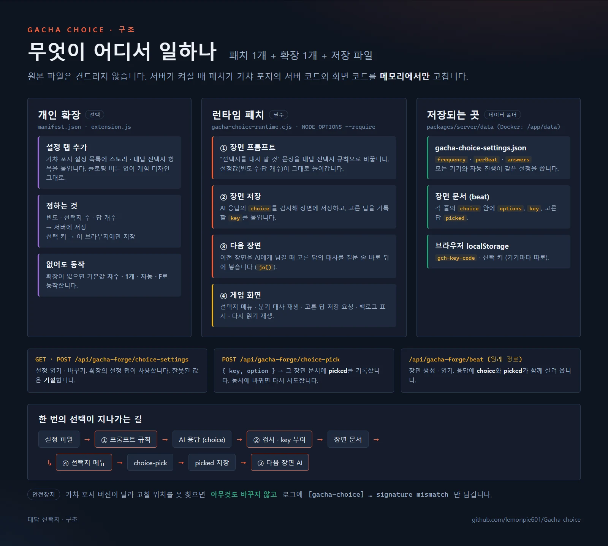
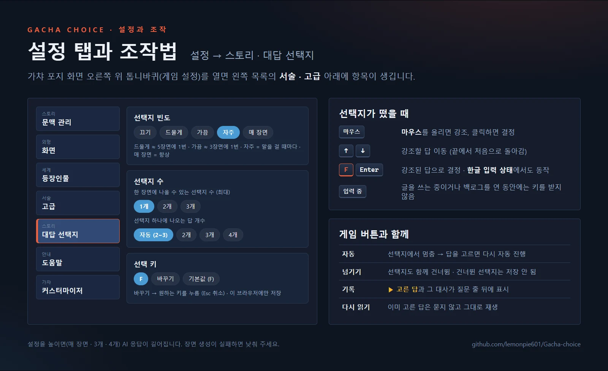
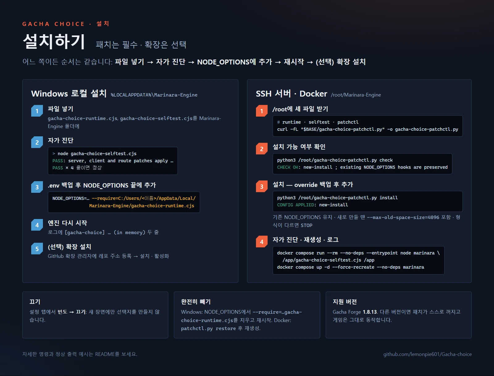

# Gacha Choice · 가챠 포지 대답 선택지

마리나라 엔진의 **가챠 포지(Gacha Forge)** 스토리에 원신 같은 **주인공 대답 선택지**를 추가하는 비공식 런타임 패치와 설정용 개인 확장입니다.

- 누군가 주인공에게 말을 걸면 대답 선택지가 뜹니다.
- 고른 답에 따라 **바로 뒤 1~3줄**이 달라지고, 그 장면은 같은 흐름으로 이어집니다.
- 고른 답은 **장면에 저장**됩니다. 다시 읽으면 고른 답이 그대로 나오고, **기록(백로그)** 에도 남고, **다음 장면을 쓸 때 AI가 주인공이 한 말을 이어받습니다**.
- 선택지 버튼은 **설정 → 외형 · 화면 → UI 스타일**(오로라 · 블룸 · 시그널 · 엠버 · 뱅가드)에 맞춰 모양과 색이 바뀝니다.
- 가챠 포지 **설정** 왼쪽 목록에 생기는 **스토리 · 대답 선택지** 항목에서 빈도(끄기 · 드물게 · 가끔 · 자주 · 매 장면), 한 장면의 선택지 수(1~3), 답 개수(자동 · 2 · 3 · 4), 선택 키를 정합니다(확장 필요).



엔진과 가챠 포지 원본 파일은 수정하지 않고, 서버가 켜질 때 메모리에서만 바꿉니다. 패치를 빼면 원래대로 돌아갑니다.

| 파일 | 역할 | 필수 |
| --- | --- | --- |
| `gacha-choice-runtime.cjs` | 서버 런타임 패치. 선택지를 만들고, 저장하고, 화면에 그립니다. | 필수 |
| `manifest.json` · `extension.js` | 개인 확장. 가챠 포지 설정 목록에 “대답 선택지” 항목을 추가합니다. 플로팅 버튼은 만들지 않습니다. | 선택 (없으면 자주 · 1개 · 자동 · F) |
| `gacha-choice-selftest.cjs` | 설치 전에 패치가 맞는지 확인하는 자가 진단 | 확인용 |
| `gacha-choice-patchctl.py` | SSH 서버(Docker)용 설치 · 복원 도구 | 서버 설치 때 |

## 동작 방식



| 위치 | 바뀌는 것 |
| --- | --- |
| 스토리 생성 프롬프트 | 원래 있던 “선택지를 절대 내지 말 것” 문장을 대답 선택지 규칙으로 바꿉니다. 빈도 · 한 장면의 선택지 수 · 답 개수 설정이 그대로 들어갑니다. 빈도가 **끄기**이면 원래 문장 그대로 둡니다. |
| 설정 | `GET/POST /api/gacha-forge/choice-settings`로 읽고 바꿉니다. 데이터 폴더의 `gacha-choice-settings.json`에 저장되어, 기기를 바꾸거나 자동 진행으로 장면이 만들어질 때도 같은 설정이 쓰입니다. |
| 장면 저장 | AI가 만든 선택지(`choice`)를 장면 데이터에 함께 저장합니다. 형식이 잘못됐거나 장면의 마지막 줄에 붙은 선택지, 설정한 수를 넘는 선택지는 버립니다. |
| 고른 답 저장 | 답을 고르면 `POST /api/gacha-forge/choice-pick`으로 그 장면 데이터에 고른 답(`picked`)을 기록합니다. |
| 다음 장면 | 이전 장면들을 AI에게 넘길 때, 선택지가 붙은 줄 바로 뒤에 **고른 답의 대사**를 넣어서 넘깁니다. 고르지 않은(건너뛴) 선택지는 넘기지 않습니다. |
| 스토리 화면 | 선택지가 붙은 줄에서 버튼을 띄우고, 고른 답의 대사를 보여 준 뒤 다음 줄로 이어 갑니다. 이미 고른 답이 있으면 묻지 않고 그 답을 재생합니다. 기록(백로그)에는 `▶ 고른 답`과 그 대사가 함께 나옵니다. |



- 대사 번호(`09 / 91`)는 분기 대사가 나오는 동안에도 그대로 유지됩니다.
- 선택지는 마우스나 **↑ / ↓ 화살표**로 고르고, **선택 키**(기본 **F**) 또는 Enter, 클릭으로 정합니다. 한글 입력 상태에서도 선택 키가 동작합니다.
- 선택 키는 설정의 **대답 선택지 → 선택 키 → 바꾸기**를 누른 뒤 원하는 키를 누르면 바뀝니다(Esc: 취소, **기본값 (F)**: 되돌리기). ↑ / ↓, Enter, Tab, Esc 같은 키는 쓸 수 없습니다. 이 기기(브라우저)에만 저장되므로 기기마다 따로 정할 수 있습니다. 선택지가 떠 있을 때만 키를 받고, 글을 입력하는 중이거나 백로그를 연 동안에는 받지 않습니다.
- **자동** 모드는 선택지에서 멈췄다가, 답을 고르면 다시 이어 갑니다. **건너뛰기**를 누르면 선택지도 함께 건너뛰고, 그 선택지는 저장되지 않습니다.
- 한 장면 안에서는 어느 답을 골라도 같은 다음 줄로 이어집니다(장면은 미리 만들어져 있기 때문입니다). 고른 답이 이야기에 반영되는 건 **다음 장면부터**입니다.
- 패치를 적용하기 **전에** 만들어진 장면에는 선택지가 없습니다. 새로 만드는 장면부터 나옵니다.
- 이전 버전(v1)에서 만든 선택지에는 저장용 키가 없어서, 고른 답이 저장되지 않습니다.

## 지원 버전

- 마리나라 엔진 2.5.1 / **Gacha Forge 1.8.13**에서 확인했습니다. 기존 Windows 로컬 패치(한국어 스탠딩, CG, NovelAI 지연, customizer, WebP)와 함께 켠 상태에서 테스트했습니다.
- 다른 버전에서는 고칠 위치를 찾지 못하면 **아무것도 바꾸지 않고** 로그에 `[gacha-choice] ... signature mismatch`를 남깁니다. 게임은 원래대로 동작합니다.

## 설치 (Windows 로컬 설치)



원격 서버나 Docker로 운영한다면 아래 [설치 (SSH 서버 · Docker Compose)](#설치-ssh-서버--docker-compose)를 보세요.

1. `gacha-choice-runtime.cjs`와 `gacha-choice-selftest.cjs`를 `Marinara-Engine` 폴더(보통 `%LOCALAPPDATA%\Marinara-Engine`)에 넣습니다.
2. 먼저 자가 진단을 실행합니다. 설치된 가챠 포지에 패치가 맞는지 파일을 바꾸지 않고 확인합니다.

   ```bat
   cd /d %LOCALAPPDATA%\Marinara-Engine
   node gacha-choice-selftest.cjs
   ```

   `PASS:` 네 줄이 나오면 정상입니다. 오류가 나오면 다음 단계로 진행하지 마세요.
3. `.env`를 백업한 뒤, `NODE_OPTIONS=` 줄 **끝에** 아래 내용을 한 칸 띄우고 추가합니다. 기존 `--require` 항목은 지우지 마세요.

   ```text
   --require=C:/Users/<사용자이름>/AppData/Local/Marinara-Engine/gacha-choice-runtime.cjs
   ```

   다른 패치와 순서는 상관없습니다(앞·뒤 어느 쪽에 두어도 함께 적용되는 것을 확인했습니다).

4. 마리나라 엔진을 다시 시작합니다. 서버 로그에 아래 두 줄이 보이면 적용된 것입니다.

   ```text
   [gacha-choice] route hooked for VN choices (in memory)
   [gacha-choice] reply choices enabled in beat prompt (in memory)
   ```

   서버 로그는 가챠 포지 화면을 한 번 열어야 두 번째 줄까지 나올 수 있습니다.
5. (선택) 빈도 · 선택지 수 · 답 개수 · 선택 키 설정 화면을 쓰려면 Marinara의 **GitHub 확장 관리자**에 아래 주소를 등록하고 확장을 설치·활성화합니다.

   ```text
   https://github.com/lemonpie601/Gacha-choice
   ```

   가챠 포지 **설정** 왼쪽 목록의 “서술 · 고급” 아래에 **스토리 · 대답 선택지** 항목이 생깁니다. 커스터마이저 탭과 같은 방식이라 함께 써도 서로 겹치지 않습니다. 서버 패치 없이 확장만 설치하면 “서버 패치가 적용되어 있지 않습니다”라고 표시됩니다.

## 설치 (SSH 서버 · Docker Compose)

### 사전 준비 — SSH로 서버에 접속해 주세요

마리나라 엔진을 Docker Compose로 운영하는 서버에 SSH로 접속한 뒤 아래 명령어를 실행해 주세요. 기본 설치 경로가 `/root/Marinara-Engine`이고, 서버에 `curl`, `python3`, `docker compose`가 있다고 가정합니다. 한국어 · CG 패치와 같은 방식이며, 기존 패치 설정은 그대로 둡니다.

> 설치 도구(`gacha-choice-patchctl.py`)는 한국어 패치의 설치 도구 구조를 따라 만들었으며, 실제 Docker 서버에서는 아직 실행해 보지 않았습니다. 각 단계의 출력이 예시와 다르면 다음 단계로 진행하지 마세요.

GitHub에서 서버로 바로 내려받습니다.

```bash
cd /root
BASE=https://raw.githubusercontent.com/lemonpie601/Gacha-choice/main
curl -fL "$BASE/gacha-choice-runtime.cjs"  -o gacha-choice-runtime.cjs
curl -fL "$BASE/gacha-choice-selftest.cjs" -o gacha-choice-selftest.cjs
curl -fL "$BASE/gacha-choice-patchctl.py"  -o gacha-choice-patchctl.py
```

### ① 설치 가능 여부 확인

```bash
python3 /root/gacha-choice-patchctl.py status
python3 /root/gacha-choice-patchctl.py check
```

일반적으로 다음과 같이 출력됩니다.

```text
gacha-choice configured: False backup: False
CHECK OK: new-install ; existing NODE_OPTIONS hooks are preserved
```

`STOP:`으로 시작하는 메시지가 나오면 설치하지 말고 안내에 따라 설정을 확인해 주세요.

### ② 설치

```bash
python3 /root/gacha-choice-patchctl.py install
```

```text
CONFIG APPLIED: new-install
```

`docker-compose.override.yml`을 백업한 뒤, 패치 파일 두 개를 `/app`에 읽기 전용으로 연결하고 `NODE_OPTIONS` 끝에 `--require=/app/gacha-choice-runtime.cjs`를 덧붙입니다. `NODE_OPTIONS`를 새로 만들 때는 이미지 기본값 `--max-old-space-size=4096`도 함께 넣습니다. 설정 검사(`docker compose config`)에 실패하면 원래대로 되돌립니다.

### ③ 자가 진단 후 마리나라 재시작

②번에서 성공 메시지를 확인했을 때만 실행해 주세요.

```bash
cd /root/Marinara-Engine
docker compose run --rm --no-deps --entrypoint node marinara /app/gacha-choice-selftest.cjs /app
docker compose up -d --force-recreate --no-deps marinara
```

자가 진단에서 `PASS`가 네 줄 나와야 합니다. 진행 중인 장면 생성이 있다면 끝난 뒤 재시작해 주세요. 데이터 볼륨은 지우지 않습니다.

### ④ 정상 작동 확인

```bash
python3 /root/gacha-choice-patchctl.py status
docker logs --since 10m marinara-engine-marinara-1 2>&1 | grep 'gacha-choice' | tail -20
```

`gacha-choice configured: True`가 나와야 합니다. 로그의 `hook registered`는 로더 등록일 뿐입니다. 가챠 포지 화면을 연 뒤 아래 두 줄이 보이면 실제로 적용된 것입니다. 컨테이너 이름이 다르면 `docker compose logs marinara`를 쓰세요.

```text
[gacha-choice] route hooked for VN choices (in memory)
[gacha-choice] reply choices enabled in beat prompt (in memory)
```

브라우저에서 마리나라를 **강력 새로고침(Ctrl + Shift + R)** 한 뒤 새 스토리 장면에서 선택지가 뜨는지 확인해 주세요. `signature mismatch`가 보이면 가챠 포지 버전이 달라 패치가 꺼진 상태이며, 게임은 원래대로 동작합니다.

### 업데이트

①의 `curl` 세 줄로 파일을 다시 받은 뒤 `python3 /root/gacha-choice-patchctl.py install`을 실행하고 ③을 다시 진행합니다. 이미 설치돼 있으면 설정은 그대로 두고 패치 파일만 바꿉니다.

### 이전 설정으로 복원 (제거)

```bash
python3 /root/gacha-choice-patchctl.py restore
cd /root/Marinara-Engine
docker compose up -d --force-recreate --no-deps marinara
```

설치 직전의 `docker-compose.override.yml`로 되돌립니다. **설치 후 Compose를 직접 고쳤다면** 다른 패치를 덮어쓰지 않도록 자동 복원이 멈추니, 추가된 두 줄의 마운트와 `--require=/app/gacha-choice-runtime.cjs`를 직접 지워 주세요.

## 끄기

- 새 장면에만 끄려면 설정의 **대답 선택지 → 끄기**를 고르세요. 이미 만든 장면의 선택지는 그대로 나옵니다.
- 완전히 빼려면 `.env`의 `NODE_OPTIONS`에서 `--require=...gacha-choice-runtime.cjs` 부분을 지우고 엔진을 다시 시작하세요. 이미 저장된 선택지와 고른 답 데이터는 남지만, 패치가 없으면 화면에 보이지 않고 다음 장면에도 전달되지 않습니다.

## 알려진 한계

- 선택지가 나올지, 언제 나올지는 AI가 정합니다. 모델에 따라 거의 안 나오거나 어색할 수 있습니다. 테스트에서는 “자주” 설정으로 만든 83줄짜리 장면에 선택지 1개(답 3개, 각 2줄)가 들어갔고, 장면 생성은 실패 없이 끝났습니다.
- 다음 장면의 AI가 고른 답을 얼마나 이어받을지는 모델에 따라 다릅니다. 고른 답이 이전 장면 내용에 들어가는 것까지는 확인했지만, 그 뒤 AI가 실제로 어떻게 반영하는지는 아직 실제 생성으로 확인하지 않았습니다.
- “매 장면”, 한 장면 선택지 2~3개, 답 4개 같은 설정은 AI 응답이 길어집니다. 모델의 출력 길이가 짧으면 장면 생성이 실패할 수 있으니, 실패하면 설정을 낮춰 주세요.
- 가챠 포지가 업데이트되면 이 패치도 새 버전에 맞게 고쳐야 합니다. 맞지 않으면 위에서 말한 것처럼 자동으로 꺼집니다.
